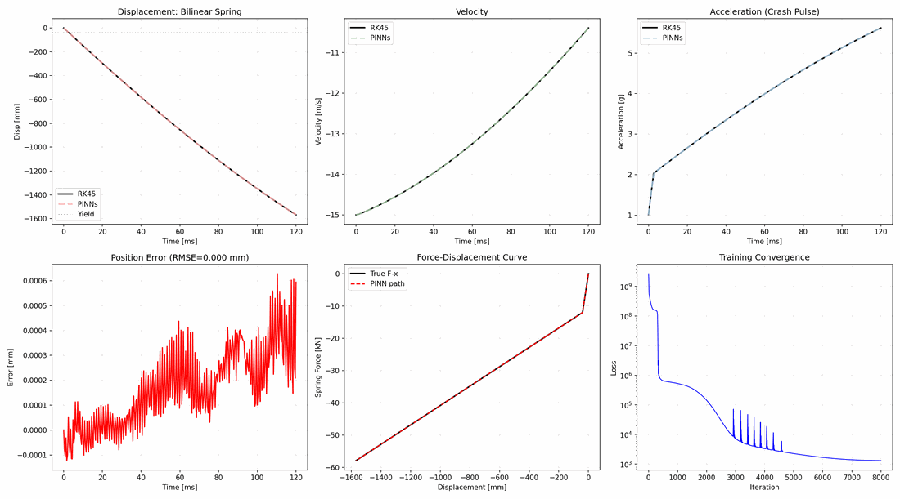

# deep-learning-model-pytorch

A small, runnable collection of classic deep-learning and scientific-machine-learning
examples in PyTorch. Every example is a self-contained teaching case: it has a
command-line entry point, deterministic seeds, CPU-friendly smoke mode, and saves its
figures/checkpoints to an ignored `outputs/` directory.

> This is **not** a paper-reproduction repository. The examples were written for study
> and reworked for clarity and portability. Numbers obtained here are illustrative and
> are not the published results of the original papers.

## What is inside

| Family | Models | Task | Entry point |
| --- | --- | --- | --- |
| Tabular regression | ANN, GRNN, RBF network, RBF / griddata interpolation | Crashworthiness performance from 6 structural parameters | `examples/tabular_regression` |
| Gaussian processes | GP regression (fixed / optimized hyperparameters, observation noise) | 1-D `cos(x)` regression with confidence bands | `examples/gpr` |
| Generative models | Simplified diffusion U-Net, masked-convolution PixelCNN, VQ-VAE | MNIST reconstruction / sampling | `examples/mnist_generative` |
| Sequence model | Frame-level encoder–decoder Transformer | Moving-MNIST next-frame prediction | `examples/temporal_transformer` |
| Operator learning | DeepONet + FNN baseline | 1-D integral, 2-D forced pendulum, 1-D diffusion | `examples/deeponet` |
| Scientific ML | PINNs (strong / energy form), collision operator, PINO fine-tuning | Crash-response prediction of a spring–mass system | `examples/sciml_crash` |

Each family has its own README with details and commands:

- [examples/tabular_regression/README.md](examples/tabular_regression/README.md)
- [examples/gpr/README.md](examples/gpr/README.md)
- [examples/mnist_generative/README.md](examples/mnist_generative/README.md)
- [examples/temporal_transformer/README.md](examples/temporal_transformer/README.md)
- [examples/deeponet/README.md](examples/deeponet/README.md)
- [examples/sciml_crash/README.md](examples/sciml_crash/README.md)



*Illustrative result from the author's original study, not produced by a full rerun of
the code in this repository. See [docs/FIXED_ISSUES.md](docs/FIXED_ISSUES.md).*

## Quick start

```bash
git clone git@github.com:JamXie/deep-learning-model-pytorch.git
cd deep-learning-model-pytorch
python -m venv .venv
# Windows: .venv\Scripts\activate
# Linux/macOS: source .venv/bin/activate
pip install -r requirements-dev.txt

# 77 smoke tests, no downloads, no training (a few seconds on CPU)
python -m pytest
```

Tested with Python 3.10, PyTorch 1.13 (CPU build), NumPy 1.26, SciPy 1.15,
pandas 1.5, scikit-learn 1.7 and matplotlib 3.7.

## Running an example

Run everything as a module from the repository root:

```bash
python -m examples.tabular_regression.ann --epochs 300
python -m examples.gpr.gpr_basic
python -m examples.mnist_generative.mnist_diffusion --epochs 5
python -m examples.temporal_transformer.generate_moving_mnist --num-samples 600
python -m examples.temporal_transformer.temporal_transformer --epochs 10
python -m examples.deeponet.data_build.build_1d_integral --num-train 2000 --num-val 500
python -m examples.deeponet.train --task 1d --epochs 200
python -m examples.sciml_crash.pinns.case_linear --iters 5000
```

Common arguments shared by the entry points (see `common/cli.py`):

| Argument | Meaning |
| --- | --- |
| `--seed` | Random seed (default `42`) for `random`, NumPy and PyTorch |
| `--device` | `auto` / `cpu` / `cuda` |
| `--data-root` | Override the data directory (fallback: `DLM_DATA_ROOT`) |
| `--output-dir` | Explicit output directory (fallback: `DLM_OUTPUT_ROOT`, then `outputs/`) |
| `--limit-batches` | Stop each epoch after N batches (smoke runs) |
| `--epochs`, `--batch-size` | Training length and batch size where applicable |

Fast smoke checks use `--epochs 1 --limit-batches 1` or `--iters 20`, depending on the
example. See [docs/REPRODUCIBILITY.md](docs/REPRODUCIBILITY.md) for the exact commands
and expected files.

## Repository layout

```text
common/          shared seed / device / path / plotting / CLI helpers
data/            the single committed CSV (+ README describing all data)
examples/        one directory per family, each with a README
docs/            data, reproducibility and fix notes; three sample figures
tests/           CPU-only smoke tests (no downloads, no training)
```

## Data and outputs

- The only committed dataset is `data/crashworthiness/result_1ct_oblique_load.csv`
  (600 rows, GB2312 encoded), exported from the author's own finite-element simulation.
  Column descriptions are in [data/README.md](data/README.md).
- MNIST is downloaded automatically by `torchvision` into `data/mnist/`.
- Moving MNIST is generated into `data/moving_mnist/` by
  `examples/temporal_transformer/generate_moving_mnist.py`.
- DeepONet datasets (`.xlsx`) and SciML datasets (`.pkl`) are generated under
  `outputs/`; model checkpoints and figures go there too.

`data/mnist/`, `data/moving_mnist/` and `outputs/` are git-ignored. The full data
contract is documented in [docs/DATA.md](docs/DATA.md).

## Tests

`python -m pytest` runs 77 tests in a few seconds on CPU. They cover forward-pass
shapes, deterministic data generation, mask causality, Excel round-trips, the RK45
reference solver, autograd derivatives and the PINO residual. No test downloads a
dataset or trains a model. Optional markers `requires_data` and `optional` are
registered in `pytest.ini` for future data-dependent tests.

## License and attribution

Original code in this repository is released under the MIT License
(see [LICENSE](LICENSE)). Third-party ideas, papers and reference implementations are
listed in [NOTICE](NOTICE); no upstream source code, dataset or pretrained weight is
redistributed. The vendored DeepXDE tree that accompanied the original study workspace
is intentionally **not** included (DeepXDE is LGPL-2.1).

The figures in `docs/assets/` are illustrative results from the author's earlier
experiments with the same models; they are not an exact output of the current code.
