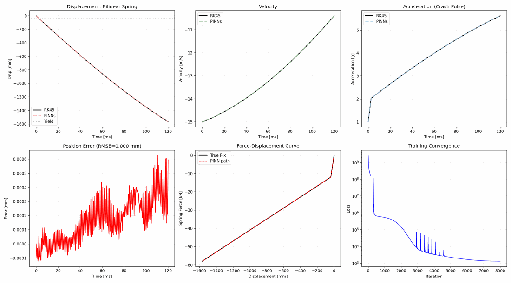

# deep-learning-model-pytorch

一个精简、可直接运行的经典深度学习与科学机器学习算例合集（PyTorch）。每个算例都是
自包含的教学示例：有命令行入口、固定随机种子、可在 CPU 上快速冒烟，并把图片与权重
写入被忽略的 `outputs/` 目录。

> 本仓库**不是**论文复现代码。示例用于学习，并为可读性与可移植性做过整理；这里得到
> 的数值仅作演示，不代表原论文的发表结果。

## 收录内容

| 分组 | 示例 | 任务 | 入口目录 |
| --- | --- | --- | --- |
| 表格回归 | ANN、GRNN、RBF 网络 | 由 6 个结构参数预测压溃性能 | `examples/ann`、`examples/grnn`、`examples/rbf_network` |
| 插值基线 | RBF / griddata 插值 | 同一数据上的非参数基线 | `examples/interpolation` |
| 高斯过程 | GP 回归（固定/优化超参数、观测噪声） | 一维 `cos(x)` 回归与置信带 | `examples/gpr` |
| 生成模型 | 简化扩散 U-Net、掩码卷积 PixelCNN、VQ-VAE | MNIST 重建 / 采样 | `examples/diffusion`、`examples/pixelcnn`、`examples/vqvae` |
| 序列模型 | Moving MNIST 生成器、帧级 Transformer | Moving MNIST 后续帧预测 | `examples/moving_mnist`、`examples/transformer` |
| 算子学习 | DeepONet + FNN 基线 | 一维积分、二维受迫单摆、一维扩散 | `examples/deeponet` |
| 科学机器学习 | PINNs（强形式/能量形式）、碰撞算子、PINO 微调 | 弹簧-质量系统碰撞响应预测 | `examples/sciml_crash` |

建议先看[模型索引](examples/README.md)或[学习路径](docs/LEARNING_PATH.md)；每个模型
目录都有自己的 README。



*示意图来自作者早期实验，并非当前代码的完整重跑结果，详见
[docs/FIXED_ISSUES.md](docs/FIXED_ISSUES.md)。*

## 快速开始

```bash
git clone git@github.com:JamXie/deep-learning-model-pytorch.git
cd deep-learning-model-pytorch
python -m venv .venv
# Windows: .venv\Scripts\activate
# Linux/macOS: source .venv/bin/activate
pip install -r requirements-dev.txt

# 77 个冒烟测试，不下载数据、不训练（CPU 数秒完成）
python -m pytest
```

已在 Python 3.10、PyTorch 1.13（CPU）、NumPy 1.26、SciPy 1.15、pandas 1.5、
scikit-learn 1.7、matplotlib 3.7 下验证。

## 运行算例

在仓库根目录以模块方式运行：

```bash
python -m examples.ann.train --epochs 300
python -m examples.gpr.gpr_basic
python -m examples.diffusion.train --epochs 5
python -m examples.moving_mnist.generate --num-samples 600
python -m examples.transformer.train --epochs 10
python -m examples.deeponet.data_build.build_1d_integral --num-train 2000 --num-val 500
python -m examples.deeponet.train --task 1d --epochs 200
python -m examples.sciml_crash.pinns.case_linear --iters 5000
```

各入口共享的公共参数（见 `common/cli.py`）：

| 参数 | 含义 |
| --- | --- |
| `--seed` | 随机种子（默认 `42`），同时作用于 `random`、NumPy 与 PyTorch |
| `--device` | `auto` / `cpu` / `cuda` |
| `--data-root` | 覆盖数据目录（默认读环境变量 `DLM_DATA_ROOT`） |
| `--output-dir` | 显式输出目录（默认 `DLM_OUTPUT_ROOT`，再退回 `outputs/`） |
| `--limit-batches` | 每个 epoch 只跑 N 个 batch，便于冒烟 |
| `--epochs`、`--batch-size` | 训练轮数与批大小（适用于训练类入口） |

快速冒烟可用 `--epochs 1 --limit-batches 1` 或 `--iters 20`。完整命令与预期输出见
[docs/REPRODUCIBILITY.md](docs/REPRODUCIBILITY.md)。

## 仓库结构

```text
common/          共享的种子 / 设备 / 路径 / 绘图 / CLI 工具
data/            唯一提交的 CSV，以及说明全部数据格式的 README
examples/        一个模型一个目录，另有 DeepONet / SciML 工程目录；
                 索引见 examples/README.md
docs/            学习路径、可复现性与修复记录；三张示意图片
tests/           仅用 CPU 的冒烟测试（不下载数据、不训练）
```

## 数据与输出

- 唯一入库的数据是 `data/crashworthiness/result_1ct_oblique_load.csv`
  （600 行，GB2312 编码），来自作者自有的有限元仿真；列含义见
  [data/README.md](data/README.md)。
- MNIST 由 `torchvision` 自动下载到 `data/mnist/`。
- Moving MNIST 由 `examples/moving_mnist/generate.py` 生成到
  `data/moving_mnist/`。
- DeepONet 的 `.xlsx` 与 SciML 的 `.pkl` 数据都生成在 `outputs/` 下，权重与图片
  同样写入 `outputs/`。

`data/mnist/`、`data/moving_mnist/` 与 `outputs/` 已被 `.gitignore` 排除。完整的
数据格式约定见 [data/README.md](data/README.md)。

## 测试

`python -m pytest` 在 CPU 上数秒内跑完 77 个测试，覆盖前向形状、数据生成确定性、
掩码因果性、Excel 往返、RK45 参考解、自动微分导数与 PINO 残差。测试不会下载数据或
训练模型。`pytest.ini` 中注册了 `requires_data` 与 `optional` 两个标记，供后续
数据相关测试使用。

## 许可与致谢

本仓库原创代码采用 MIT 许可（见 [LICENSE](LICENSE)）。第三方思想、论文与参考实现
列在 [NOTICE](NOTICE) 中；不转发任何上游源码、数据集或预训练权重。原研究目录中
附带的 DeepXDE 源码树**未**收录（DeepXDE 为 LGPL-2.1）。

`docs/assets/` 中的图片是作者早期同类实验的示意结果，并非当前代码的精确复现输出。
